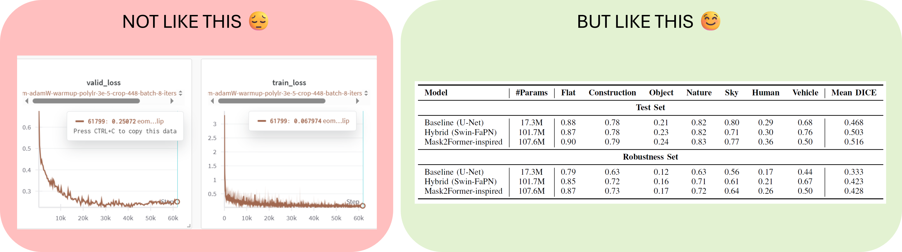

# Report & grading

Your report is the main thing we grade. This page lists what you hand in, how it is graded, and how to write a strong paper.

## What you hand in

1. **A research paper** of **3-4 pages** in [IEEE double-column format](https://www.overleaf.com/latex/templates/ieee-conference-template/grfzhhncsfqn), as a PDF via **Canvas**. Text beyond 4 pages (references excluded) is not graded.
2. **Your code** in a **public GitHub repository** (your fork). Its README lists:
    - the required libraries and how to install them,
    - the commands to train and evaluate your models, so we can reproduce your results,
    - your challenge-server username and TU/e email address.
3. **Challenge submissions**: the Dice track plus at least one other track, on both the validation and the hidden test server (see [Submitting](submission.md)).

## How it is graded

The paper is graded on **clarity, experimental design, insight and originality**. The final assignment counts for **50% of your course grade**.

Bonus points, added to your final assignment grade:

- **Top 3 in a track**: +0.25.
- **Best in a track**: +0.5.

Bonuses add up over tracks (for example, best in Dice and top 3 in Consistency gives +0.75). They are optional: a great report with an interesting method that does not rank highly can still get a 10.

## Paper structure

- **Abstract**: problem, approach and main findings in 100-300 words.
- **Introduction**: the problem, its challenges, related work, and a link to your code. For example: *"The code is publicly available at https://github.com/..."*
- **Methods**: the data, the baseline of every track you took part in, and your improvements.
- **Results**: hidden-test scores for every track, each compared to that track's baseline, with figures, tables and qualitative examples (masks, generated frames).
- **Discussion**: what worked and why, what didn't, limitations, and future work.

## Do's ✅

- **Report hidden test results.** Your main results are the scores from the hidden test server. Use `val` and validation-server scores for model selection and analysis. Comparing them with the hidden test scores is interesting: the hidden test set has new videos annotated by surgeons, so the gap shows how well your model generalises.
- **Compare every track to its own baseline.** Your consistency model against the consistency baseline, and so on. The baselines are already provided, so these are easy points.
- **Report all metrics of a track**, not only the ranked one: Dice and Change Dice for consistency; Dice and FPS for real-time; FVD, FID and mask Dice for generative.
- **Use a subsection per track** for its method and results. That keeps the paper easy to follow.
- **Train your models properly.** *"The model had not converged"* is not an explanation: there is enough compute for everyone. Submit the model that did best on validation.
- **Make clear figures and tables.** Label them, refer to them in the text ("as shown in Fig. 1"), and keep the text in them no more than two font sizes smaller than the body text. Use `figure*` in LaTeX for a figure across both columns.
- **Cite your sources**, for ideas, methods and code, in one consistent style (e.g. IEEE).
- **Proofread**, and ask a fellow student to read your paper.
- **Be honest.** A well-analysed failure can be as valuable as a success.

## Don'ts ❌

- **Don't present validation results as final results.** Only the hidden test set gives a reliable estimate.
- **Don't paste screenshots** of W&B plots or Excel tables. Make clean figures and tables instead. Only show loss curves if your discussion needs them.
- **Don't overload the paper with jargon.** Write for a reader with a technical background who doesn't know your project.
- **Don't skip the discussion.** Reflect on why things worked or didn't.
- **Don't let GenAI write your paper.** Using it to check grammar and spelling is fine, but a report written by GenAI counts as plagiarism.
- **Don't plagiarise.** Plagiarism gives a **zero** for the report.

A clean results table looks like this:

Start writing early, and ask questions in the **Discussions** section of the repository.

Next: [FAQ](faq.md).
