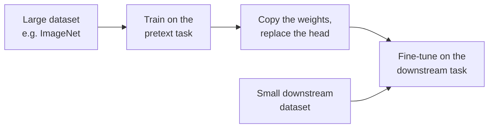

# 6.1 Transfer learning

Part of [6. Self-supervised and transfer learning](README.md). [Slides 2-10](slides.pdf#page=2).

> [!TIP]
> **Key takeaways**
>
> - Start from a pretrained model, unless you have a very good reason not to.
> - Use it as a frozen feature extractor, or fine-tune it with a small learning rate that is lowest for the early layers.
> - The less data you have and the more similar it is to the pretraining data, the less of the network you train.

## Notes

### Reusing what a network already learned

There is an abundance of labeled data, just not for *our* task. ImageNet alone has over a million labeled photos. *Transfer learning* reuses the knowledge a network gained on one task or dataset (the *pretext* or *source* task) as the starting point for a new task (the *downstream* or *target* task), and adapts it to the new purpose.



There are two ways to reuse a pretrained network.

### Option 1: a frozen feature extractor

Run your images through the pretrained network, take the activations of one of the last layers as a feature vector, and train a separate classifier (a linear layer, an SVM, a small MLP, or k-nearest neighbors) on these features.

- The pretrained network is not changed, so you compute the features only once.
- It is cheap and works well when you have little labeled data.
- The features only help if they capture what matters for your task.

### Option 2: fine-tuning

Copy the pretrained weights into the downstream model, replace the task-specific head, and continue training on the new task with a **small learning rate**. You choose which layers to train:

- only the final layers, with the rest of the network frozen;
- all layers, with a learning rate that **decreases from the output towards the input**;
- all layers with the same learning rate.

Why train the early layers less? The first layers of a network learn generic features: edges, color blobs and textures, which look much like the filters of classical signal processing and are useful for almost any image. The AlexNet paper already showed this by plotting its first-layer filters. The later layers combine these generic features into task-specific concepts, so that is where most of the adaptation has to happen. The whole model stays differentiable, so it is trained end to end even when some layers are frozen. Oquab et al. (CVPR 2014) were among the first to show this, transferring ImageNet features to object detection.

A useful middle way is to **first train only the new head** on frozen features, and then fine-tune the whole network. A randomly initialized head produces large, noisy gradients at the start, which can damage the pretrained features before the head has learned anything (Kumar et al., 2022).

### Choosing a strategy

What to fine-tune depends on how much downstream data you have and how similar it is to the pretraining data:

| | Small downstream dataset | Large downstream dataset |
| --- | --- | --- |
| **Similar data** | Reuse the features, or fine-tune the final layers | Fine-tune the final layers, or the full model with a decreasing learning rate |
| **Different data** | Fine-tune the full model with a decreasing learning rate | Fine-tune the full model |

With little data, training many weights overfits, so you change as little as possible. With very different data, the later features don't fit, so more of the network has to adapt.

### Parameter-efficient fine-tuning

Foundation models ([6.7](7-foundation-models.md)) have hundreds of millions to billions of parameters. Fine-tuning all of them is expensive, and you would store a full copy of the model for every task. *Parameter-efficient fine-tuning* keeps the pretrained model frozen and trains only a small number of added parameters:

- **Adapters**: small bottleneck layers inserted between the layers of the frozen network.
- **LoRA** (low-rank adaptation): every weight matrix $W$ is kept frozen, and a low-rank update is learned next to it, $W + BA$, where $B$ and $A$ have a small inner dimension $r$ (for example 8). After training, $BA$ can be merged into $W$, so inference costs nothing extra.
- **Prompt tuning**: learnable tokens are added to the input of a vision transformer, while the transformer itself stays frozen.

These methods often reach the accuracy of full fine-tuning while training less than 1% of the parameters, and they overfit less on small datasets.

### Limits of transfer learning

- **The input must be compatible.** A ResNet pretrained on ImageNet expects 2D RGB images; it cannot be adapted directly to 3D volumes such as MRI or CT scans.
- **Domain matters.** ImageNet features transfer surprisingly well, even to ultrasound, but pretraining on data from your own domain usually works better. This is a good reason to add an (unsupervised) pretraining stage on in-domain data, if you can afford it. The rest of this topic shows how to do that without labels.

## In practice

**Where to get pretrained weights:** [torchvision](https://pytorch.org/vision/stable/models.html) (classic CNNs and ViTs, ImageNet), [timm](https://huggingface.co/docs/timm) (hundreds of image models, including self-supervised ones), and the [Hugging Face Hub](https://huggingface.co/models) (most recent foundation models, see [6.7](7-foundation-models.md)).

Replace the head and freeze everything except the last block:

```python
import torch
from torchvision.models import resnet50, ResNet50_Weights

model = resnet50(weights=ResNet50_Weights.IMAGENET1K_V2)
model.fc = torch.nn.Linear(model.fc.in_features, num_classes)   # new head for your task
for name, param in model.named_parameters():
    param.requires_grad = name.startswith(("layer4", "fc"))     # train only the last block and the head
```

Or train everything, with a learning rate that decreases towards the input (one parameter group per stage):

```python
stages = [model.conv1, model.bn1, model.layer1, model.layer2, model.layer3, model.layer4, model.fc]
base_lr, decay = 1e-3, 0.5                                      # each earlier stage gets half the learning rate
optimizer = torch.optim.AdamW([
    {"params": stage.parameters(), "lr": base_lr * decay ** (len(stages) - 1 - i)}
    for i, stage in enumerate(stages)
])
```

**In the final assignment**, every baseline already starts from ImageNet weights. Replacing them by a stronger or in-domain backbone is one of the most effective improvements you can make; [6.7](7-foundation-models.md#in-practice) lists good candidates. In your `predictor.py`, build the model without downloading weights and load your own checkpoint, because the challenge server has no internet.

## Check your understanding

<details class="question" markdown="1">
<summary>Why do we use a smaller learning rate for the early layers than for the later ones?</summary>

The early layers compute generic features (edges, colors, textures) that are useful for almost any image, so they need little change. The later layers combine these into task-specific concepts and have to adapt most. A large learning rate in the early layers would mainly destroy useful features.

</details>

<details class="question" markdown="1">
<summary>You have 500 labeled chest X-rays and an ImageNet-pretrained ResNet. What would you fine-tune, and why?</summary>

The dataset is small and quite different from ImageNet (grayscale, medical). Following the table: fine-tune the full model, with a learning rate that decreases towards the input, and preferably train the head on frozen features first. If you can find a model pretrained on X-rays, start from that instead.

</details>

<details class="question" markdown="1">
<summary>When does training from scratch make sense?</summary>

When no pretrained model accepts your input (for example 3D volumes or unusual sensor data), when your data is so different that pretrained features don't help, or when you have enough data and compute to pretrain on your own domain, which is exactly what self-supervised learning enables.

</details>

## Further reading

- M. Oquab, L. Bottou, I. Laptev and J. Sivic, "Learning and transferring mid-level image representations using convolutional neural networks," *CVPR*, 2014. [Paper](https://openaccess.thecvf.com/content_cvpr_2014/html/Oquab_Learning_and_Transferring_2014_CVPR_paper.html)
- J. Yosinski, J. Clune, Y. Bengio and H. Lipson, "How transferable are features in deep neural networks?," *NeurIPS*, 2014. [arXiv](https://arxiv.org/abs/1411.1792). Measures layer by layer how general or task-specific features are.
- S. Kornblith, J. Shlens and Q. V. Le, "Do better ImageNet models transfer better?," *CVPR*, 2019. [arXiv](https://arxiv.org/abs/1805.08974)
- J. Howard and S. Ruder, "Universal language model fine-tuning for text classification," *ACL*, 2018. [arXiv](https://arxiv.org/abs/1801.06146). Introduces discriminative (layer-wise) learning rates and gradual unfreezing.
- A. Kumar et al., "Fine-tuning can distort pretrained features and underperform out-of-distribution," *ICLR*, 2022. [arXiv](https://arxiv.org/abs/2202.10054). Why training a linear head first, then fine-tuning, is often better.
- M. Raghu, C. Zhang, J. Kleinberg and S. Bengio, "Transfusion: Understanding transfer learning for medical imaging," *NeurIPS*, 2019. [arXiv](https://arxiv.org/abs/1902.07208)
- N. Houlsby et al., "Parameter-efficient transfer learning for NLP," *ICML*, 2019. [arXiv](https://arxiv.org/abs/1902.00751). Adapters.
- E. J. Hu et al., "LoRA: Low-rank adaptation of large language models," *ICLR*, 2022. [arXiv](https://arxiv.org/abs/2106.09685)
- M. Jia et al., "Visual prompt tuning," *ECCV*, 2022. [arXiv](https://arxiv.org/abs/2203.12119)

Next: [6.2 Predictive self-supervised learning](2-predictive-ssl.md).
