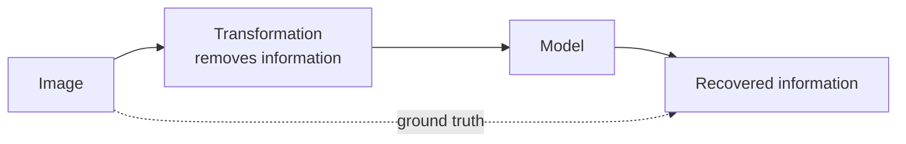

# 6.2 Predictive self-supervised learning

Part of [6. Self-supervised and transfer learning](README.md). [Slides 11-25](slides.pdf#page=11).

> [!TIP]
> **Key takeaways**
>
> - Remove information from an image and let the model restore it: the data provides its own labels.
> - The pretext task is only a means: what matters is what the network has to learn to solve it.
> - Models take shortcuts through low-level cues; design the task and its noise so that only understanding the content solves it.

## Notes

### Learning by undoing a transformation

Self-supervised learning (SSL) methods fall roughly into three families: **predictive**, **generative** ([6.4](4-masked-image-modeling.md)) and **contrastive** ([6.5](5-contrastive-learning.md)). The lines between them are not strict, but predictive methods are the oldest and laid the foundation for the others.

The idea is simple: apply a transformation that removes some information from an image, and train a model to recover it. The original image is the ground truth, so the data provides its own labels, hence *self*-supervision. The task itself (the *pretext task*) is not what we care about. What matters is that solving it forces the network to learn something about the content of images, and that knowledge transfers to the downstream task.

### Pretext tasks

- **Context prediction** (Doersch et al., 2015). Take a patch and one of its eight neighbors, and let the model predict where the neighbor lies relative to the first patch. To do this, the model has to know what objects look like and how their parts are arranged.
- **Jigsaw puzzles** (Noroozi and Favaro, 2016). Cut the image into a 3×3 grid of tiles, shuffle them, and let the model predict the permutation, that is, how to put the tiles back in order. In practice the model classifies which of a fixed set of permutations was applied.
- **Colorization** (Larsson et al., 2016; Zhang et al., 2016). Drop the color and let the model predict it from the grayscale image. Coloring a scene correctly requires recognizing objects (grass is green, the sky is blue) and their boundaries.
- **Rotation prediction** (Gidaris et al., 2018). Rotate the image by 0°, 90°, 180° or 270° and let the model predict the angle. For us this is easy because we know that dogs stand on their feet and that the sky is at the top, and that is exactly the knowledge the model has to acquire. The first-layer filters learned this way look much like those learned with supervision.

### Pitfall: shortcuts

Our downstream tasks need features about *objects*: their parts and how those are arranged. But images contain much more redundancy than that, including low-level statistics such as edges, corners, noise and lens artifacts. If a pretext task can be solved with low-level statistics, the network will learn those instead, because they are easier. This is called **shortcut learning**.

Two examples:

- **Context prediction and chromatic aberration.** Camera lenses focus different colors slightly differently, so colors shift a little towards the edges of a photo. This shift reveals where in the image a patch came from, so the model can predict the absolute location of each patch, and from that the relative location, without looking at the content at all.
- **Jigsaw puzzles and borders.** Adjacent tiles can be matched by comparing the pixels along their borders, like low-level edge continuation. The model then learns nothing about the content.

The general remedy is to **remove the redundancy that allows the shortcut**, typically by adding noise or by changing the task:

- against chromatic aberration: randomly and independently scale and shift the color channels, or drop color channels, so the color shift no longer carries location information;
- against border matching: leave gaps between the tiles and jitter their positions, so borders no longer line up.

> [!IMPORTANT]
> Shortcuts are specific to each pretext task. When you design or use one, ask: *can this task be solved without understanding the content?*

## Check your understanding

Why is the pretext task itself not important, and what is?

Nobody needs a model that predicts rotations. What matters is the representation the network builds to solve the task: if solving it requires recognizing objects and their parts, those features transfer to the downstream task.

Would rotation prediction work well for pretraining on top-down satellite images or microscopy slides?

Probably not. Such images have no natural "up": a rotated image is just as plausible as the original, so the rotation cannot be predicted from the content. The task is then either unsolvable or solved through artifacts such as the image border or the scanner's illumination pattern, which is a shortcut.

In a jigsaw puzzle, how could the model still cheat if you leave gaps between the tiles?

Through other low-level cues that continue across tiles, for example lighting gradients, chromatic aberration or JPEG compression blocks. Each cue needs its own remedy, such as color jitter, random crops within each tile and per-tile normalization.

## Further reading

- C. Doersch, A. Gupta and A. A. Efros, "Unsupervised visual representation learning by context prediction," *ICCV*, 2015. [arXiv](https://arxiv.org/abs/1505.05192)
- M. Noroozi and P. Favaro, "Unsupervised learning of visual representations by solving jigsaw puzzles," *ECCV*, 2016. [arXiv](https://arxiv.org/abs/1603.09246)
- G. Larsson, M. Maire and G. Shakhnarovich, "Learning representations for automatic colorization," *ECCV*, 2016. [arXiv](https://arxiv.org/abs/1603.06668)
- R. Zhang, P. Isola and A. A. Efros, "Colorful image colorization," *ECCV*, 2016. [arXiv](https://arxiv.org/abs/1603.08511)
- S. Gidaris, P. Singh and N. Komodakis, "Unsupervised representation learning by predicting image rotations," *ICLR*, 2018. [arXiv](https://arxiv.org/abs/1803.07728)
- R. Geirhos et al., "Shortcut learning in deep neural networks," *Nature Machine Intelligence*, 2020. [arXiv](https://arxiv.org/abs/2004.07780). Shortcuts in deep learning in general, far beyond SSL.
- A. Kolesnikov, X. Zhai and L. Beyer, "Revisiting self-supervised visual representation learning," *CVPR*, 2019. [arXiv](https://arxiv.org/abs/1901.09005). A careful comparison of pretext tasks and architectures.

Next: [6.3 Evaluating representations](3-evaluation.md).
