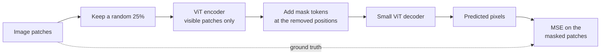

# 6.4 Masked image modeling

Part of [6. Self-supervised and transfer learning](README.md). [Slides 31-34](slides.pdf#page=31).

> [!TIP]
> **Key takeaways**
>
> - Hide a large part of the image and let the model generate what is missing.
> - Small holes can be filled by interpolation; a high masking ratio forces the model to understand the content.
> - Masked autoencoders process only the visible patches, which makes pretraining large vision transformers affordable.

## Notes

Generative self-supervised methods ask the model to *generate* the missing part of the data, not to classify a property of it. This needs an encoder-decoder architecture: the encoder learns the representation we want to keep, the decoder produces pixels. Methods in this family led to the large pretrained vision models of recent years.

### Context encoders

Context encoders (Pathak et al., 2016) remove a region of the image and train an encoder-decoder to inpaint it from the surrounding context. They could just as well be called predictive: the model undoes a transformation, but it generates the missing pixels instead of predicting a label.

The pitfall: if the removed regions are small, the model can fill them by **interpolating** the surrounding pixels, a low-level shortcut, without understanding the scene.

### Masked autoencoders (MAE)

Masked autoencoders (He et al., 2022) exploit the patch structure of a vision transformer (see [topic 4](../04-transformers/README.md)):

1. Split the image into patches and embed every patch.
2. Shuffle the patch embeddings randomly and drop most of them; only the remaining fraction is kept.
3. Run only the **visible** patches through the ViT encoder.
4. Undo the shuffling and insert a shared, learnable **mask token** for every removed patch.
5. A lightweight ViT decoder predicts the pixel values of the removed patches.
6. Compute the mean squared error on the **masked patches only**.

Two design choices make MAE work:

- **A very high masking ratio** (75% or more). Images are spatially redundant, so with a low ratio missing patches could be interpolated from their neighbors. At 75%, interpolation is no longer possible and the model has to reason about the content.
- **The encoder never sees mask tokens.** It processes only the 25% visible patches, a sparse input that a CNN cannot exploit but a transformer can. This makes pretraining several times cheaper and lets it scale to large models. After pretraining, the decoder is thrown away and the encoder is used on full images.

### Beyond pixels

Reconstructing pixels spends effort on details that don't matter, such as the exact texture of grass. Later methods predict something more abstract for the masked patches: discrete visual tokens (BEiT), or the features of another network (iBOT and I-JEPA, see [6.7](7-foundation-models.md)).

## Check your understanding

What is the pitfall of context encoders, and how does MAE avoid it?

When the removed region is small, the model can fill it by interpolating the pixels around it, without understanding the image. MAE removes 75% of the patches at random, so most patches have no visible neighbors to interpolate from.

What is the main advantage of MAE's masking over simply setting the masked pixels to zero?

Efficiency. The encoder processes only the visible 25% of the patches, so the expensive part of the network does about four times less work, and it never sees artificial mask tokens that won't appear when the model is used later. Zeroing pixels keeps the full input size and teaches the encoder to handle blank regions.

Why does this trick work for vision transformers but not for CNNs?

A transformer processes a set of tokens and can simply take fewer of them. A CNN slides its filters over a dense grid, so removed patches still have to be filled in with something, and every pixel is still computed.

## Further reading

- D. Pathak, P. Krähenbühl, J. Donahue, T. Darrell and A. A. Efros, "Context encoders: Feature learning by inpainting," *CVPR*, 2016. [arXiv](https://arxiv.org/abs/1604.07379)
- K. He, X. Chen, S. Xie, Y. Li, P. Dollár and R. Girshick, "Masked autoencoders are scalable vision learners," *CVPR*, 2022. [arXiv](https://arxiv.org/abs/2111.06377)
- H. Bao, L. Dong, S. Piao and F. Wei, "BEiT: BERT pre-training of image transformers," *ICLR*, 2022. [arXiv](https://arxiv.org/abs/2106.08254)
- Z. Xie et al., "SimMIM: A simple framework for masked image modeling," *CVPR*, 2022. [arXiv](https://arxiv.org/abs/2111.09886)
- M. Assran et al., "Self-supervised learning from images with a joint-embedding predictive architecture," *CVPR*, 2023. [arXiv](https://arxiv.org/abs/2301.08243). I-JEPA: predicts features of masked regions instead of pixels.

Next: [6.5 Contrastive learning and self-distillation](5-contrastive-learning.md).
