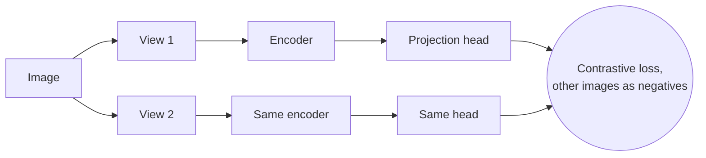
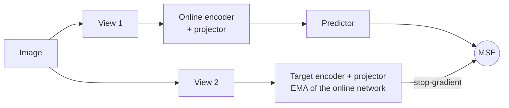
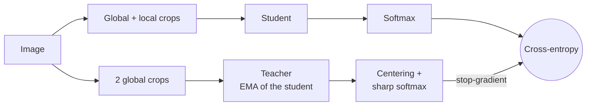

# 6.5 Contrastive learning and self-distillation

Part of [6. Self-supervised and transfer learning](README.md). [Slides 35-47](slides.pdf#page=35).

> [!TIP]
> **Key takeaways**
>
> - Two augmented views of the same image should have similar representations; the augmentations decide what the model learns to ignore.
> - Making views similar alone has a trivial solution, *collapse*; every method needs something that prevents it, which explains most design choices.
> - The field moved from contrastive losses with negatives (CPC, MoCo, SimCLR) to self-distillation without negatives (BYOL, DINO).

## Notes

Contrastive learning and its successor, self-distillation, have been a game changer: almost every recent SSL method contains some form of these losses. This page follows the main papers in the order they built on each other. Pay attention to *which trick comes from which method*, and why it helped.

### Contrastive Predictive Coding (CPC)

CPC (van den Oord et al., 2018) learns representations that capture the information *shared* between different parts of a signal, while discarding local noise. For images:

- the image is split into a grid of overlapping patches $x_{i,j}$, each encoded to $z_{i,j} = f_\theta(x_{i,j})$;
- a masked CNN $g_\phi$ summarizes the patches *above* a position into a context vector $c_{i,j}$;
- from the context, the model predicts the encodings of patches further down, $\hat z_{i+k,j} = W_k c_{i,j}$.

Instead of regressing $z_{i+k,j}$ directly, the model must pick the true future patch out of a set of candidates: the correct one (a **positive pair**) and randomly sampled other patches (**negative pairs**). This is the **InfoNCE** loss (Information Noise-Contrastive Estimation). In its general form, for a query $q$, its positive key $k^+$ and negative keys $k^-_l$:

$$
\mathcal{L}_\text{InfoNCE} = -\log \frac{\exp\big(\text{sim}(q, k^+)/\tau\big)}{\exp\big(\text{sim}(q, k^+)/\tau\big) + \sum_{l} \exp\big(\text{sim}(q, k^-_l)/\tau\big)}
$$

This is a softmax cross-entropy that classifies which candidate is the positive. CPC scores candidates with a dot product, $\text{sim}(\hat z, z) = \hat z^\top z$; later methods use the **cosine similarity** $\text{sim}(u, v) = u^\top v / (\lVert u\rVert \lVert v\rVert)$, scaled by a **temperature** $\tau$.

The temperature controls how hard the loss focuses on difficult negatives. With a small $\tau$ (typically 0.05-0.2), the softmax is sharp: the negatives most similar to the query dominate the loss and are pushed away hardest. A large $\tau$ treats all negatives more equally. Too small a temperature makes training unstable, so it is an important hyperparameter.

Minimizing InfoNCE maximizes a lower bound on the mutual information between the views, which is why it learns what they share.

### Momentum Contrast (MoCo)

MoCo (He et al., 2020) moves from patches to whole images. The key idea: **two augmentations of the same image should have similar representations.** This is the same assumption as data augmentation in supervised training, but now applied to the representation itself instead of the prediction.

- Two random augmentations of an image give a *query* and a positive *key*. Keys of other images are the negatives.
- The negatives come from a **dynamic dictionary**: a large queue of keys from previous batches, so there are many negatives without a huge batch.
- The keys are produced by a **momentum encoder**, a slowly moving copy of the query encoder: $\theta_k \leftarrow m\,\theta_k + (1-m)\,\theta_q$ with $m$ close to 1 (e.g. 0.999). This keeps the keys in the queue consistent with each other.
- The loss is InfoNCE over the positive key and the keys in the queue.

### Augmentations decide what is learned

All methods from here on compare two augmented *views* of an image. Whatever differs between the views, the model learns to ignore; whatever the views share, it can use. The augmentations therefore play the same role as the noise against shortcuts in [6.2](2-predictive-ssl.md#pitfall-shortcuts):

| Augmentation | What the model learns to ignore, or which shortcut it removes |
| --- | --- |
| Random resized crop | Position and scale; small crops must be matched to larger views of the same scene |
| Color jitter | Exact colors. Two crops of one image share a color histogram, so without jitter the model can match views by histogram alone |
| Random grayscale | Color, so shape and texture must carry the information |
| Gaussian blur | Fine texture and noise |
| Solarization | Absolute intensities |
| Horizontal flip | Left-right orientation |

SimCLR showed that the combination of **cropping and color distortion** matters most. But be careful in your own domain: if color *is* important for your task, for example to tell blood from tissue, strong color jitter removes exactly that information.

### SimCLR

SimCLR (Chen et al., 2020) is a simpler framework with the same goal. Each image in a batch of $N$ is augmented twice; for each view, the other view of the same image is the positive, and the $2(N-1)$ views of other images are the negatives. Its key addition is a **projection head**: a small MLP that maps the representation $h$ to a space $z$ where the contrastive loss is applied. After training the head is discarded and $h$ is used.

Why does the projection head help? The contrastive loss makes $z$ invariant to the augmentations, throwing away information such as color or orientation. That information can still be useful downstream; the head lets $z$ discard it while $h$ keeps it.

Its main findings:

- the **combination of augmentations** is critical, random cropping plus color distortion in particular;
- the **non-linear projection head** clearly improves the representation;
- **scaling up** helps a lot: bigger networks, larger batches (more negatives) and longer training. This is why these models are trained by large labs on thousands of GPUs, and why we download them instead of training them ourselves.

### Bootstrap Your Own Latent (BYOL)

BYOL (Grill et al., 2020) keeps the augmentations, the projection head and the moving-average (momentum) target encoder, but uses **no negative pairs at all**. An *online* network predicts, through an extra *predictor* MLP, the target network's projection of the other view, with a mean-squared error between the normalized vectors.

Without negatives there seems to be a trivial solution: map every image to the same vector, and the loss is zero. BYOL avoids this collapse in practice through the asymmetry between the two branches, as explained [below](#why-dont-they-collapse).

### DINO: self-distillation with no labels

DINO (Caron et al., 2021) keeps the student-teacher setup without negatives: the **teacher** is a momentum copy of the **student**. The difference is the loss. Instead of a distance between vectors, both networks output a softmax over $K$ dimensions, and the student is trained with a **cross-entropy** to match the teacher's distribution. This turns the task into a classification problem whose classes the model defines itself.

DINO also uses **multi-crop** training: the teacher sees only two large *global* crops, the student also sees several small *local* crops, so the student learns to relate local parts to the global image (*local-to-global* learning).

DINO works especially well with vision transformers (topic 4). Without ever seeing a label, the attention maps of the class token segment the main object in an image, and images of the same class cluster together in feature space.

### Why don't they collapse?

All these methods pull two views of an image together. On its own, that objective has a perfect but useless solution: an encoder that outputs **the same vector for every image**, or uses only a few of its dimensions. This is called **representation collapse**. Every method therefore needs a counterforce, and that need explains many of their design choices:

| Method | What prevents collapse |
| --- | --- |
| CPC, MoCo, SimCLR | **Negatives**: the denominator of InfoNCE pushes different images apart. This is why they need many negatives: large batches or a queue. |
| BYOL, SimSiam | **Asymmetry**: a predictor on one branch only, and a stop-gradient on the other (with an EMA target in BYOL). There is no explicit force against collapse, but these networks don't find the trivial solution in practice; SimSiam showed the stop-gradient is the essential part. |
| DINO | **Centering and sharpening** of the teacher output. Centering (subtracting a running mean) stops one dimension from dominating, which alone would push towards a uniform output; sharpening (a low temperature) pushes the other way. Together they balance. |
| Barlow Twins, VICReg | **Statistics of the batch**: keep the variance of every feature dimension above a threshold and decorrelate the dimensions, so information is spread over all of them. |

When you train such a model yourself, monitor the standard deviation of the embeddings over a batch: if it drops towards zero, the representation is collapsing.

### What made these methods work

| Idea | Introduced by | Why it helps |
| --- | --- | --- |
| InfoNCE loss with positives and negatives | CPC | Learns shared information, ignores local noise |
| Invariance to augmentations | MoCo, SimCLR | Two views of an image should look the same in feature space |
| Momentum (EMA) encoder | MoCo | Stable, consistent targets |
| Projection head | SimCLR | Keeps the representation free of the invariances of the loss |
| No negatives, predictor + stop-gradient | BYOL | No need for huge batches or queues |
| Self-distillation with centering and sharpening; multi-crop | DINO | Stable training without negatives; local-to-global features |

## Check your understanding

Why might it be a good idea to apply the contrastive loss after a projection head, and not on the representation directly?

The loss makes its input invariant to the augmentations, so it removes information such as color or orientation. Applying it to $z$ = head($h$) lets the head throw that information away while $h$ keeps it, and $h$ is what we use downstream. SimCLR found that $h$ gives clearly better linear-probe accuracy than $z$.

BYOL has no negative pairs. Can you spot a problem with this?

Collapse: if the online and target networks map every image to the same constant vector, the loss is exactly zero, so this trivial solution is a perfect minimum. BYOL avoids it in practice through its asymmetric design: the predictor, the stop-gradient and the slowly moving target.

What is the main difference between DINO and BYOL?

The loss. BYOL regresses the target's vector with an MSE; DINO turns both outputs into probability distributions with a softmax and uses a cross-entropy, so the student classifies each view into categories the model defines itself. DINO prevents collapse with centering and sharpening instead of a predictor, and adds multi-crop.

What happens to the InfoNCE loss when you lower the temperature?

The softmax becomes sharper: the loss is dominated by the negatives that are most similar to the query, so the model focuses on separating hard negatives. Too low a temperature makes gradients large and training unstable; too high treats all negatives alike and learns weaker features.

Why does SimCLR need color jitter when it already uses random crops?

Two crops of the same image have almost the same color distribution, so the model can match them by comparing color histograms, a shortcut. Color jitter makes the histograms differ, so the model has to compare content instead.

## Further reading

- A. van den Oord, Y. Li and O. Vinyals, "Representation learning with contrastive predictive coding," 2018. [arXiv](https://arxiv.org/abs/1807.03748)
- K. He, H. Fan, Y. Wu, S. Xie and R. Girshick, "Momentum contrast for unsupervised visual representation learning," *CVPR*, 2020. [arXiv](https://arxiv.org/abs/1911.05722)
- T. Chen, S. Kornblith, M. Norouzi and G. Hinton, "A simple framework for contrastive learning of visual representations," *ICML*, 2020. [arXiv](https://arxiv.org/abs/2002.05709)
- J.-B. Grill et al., "Bootstrap your own latent: A new approach to self-supervised learning," *NeurIPS*, 2020. [arXiv](https://arxiv.org/abs/2006.07733)
- X. Chen and K. He, "Exploring simple Siamese representation learning," *CVPR*, 2021. [arXiv](https://arxiv.org/abs/2011.10566). SimSiam: why methods without negatives don't collapse.
- M. Caron et al., "Emerging properties in self-supervised vision transformers," *ICCV*, 2021. [arXiv](https://arxiv.org/abs/2104.14294)
- J. Zbontar, L. Jing, I. Misra, Y. LeCun and S. Deny, "Barlow Twins: Self-supervised learning via redundancy reduction," *ICML*, 2021. [arXiv](https://arxiv.org/abs/2103.03230)
- A. Bardes, J. Ponce and Y. LeCun, "VICReg: Variance-invariance-covariance regularization for self-supervised learning," *ICLR*, 2022. [arXiv](https://arxiv.org/abs/2105.04906). Prevents collapse explicitly, with a variance and a covariance term.
- F. Wang and H. Liu, "Understanding the behaviour of contrastive loss," *CVPR*, 2021. [arXiv](https://arxiv.org/abs/2012.09740). What the temperature does.
- T. Wang and P. Isola, "Understanding contrastive representation learning through alignment and uniformity on the hypersphere," *ICML*, 2020. [arXiv](https://arxiv.org/abs/2005.10242). What the contrastive loss optimizes, geometrically.

Next: [6.6 Weak supervision and vision-language models](6-weak-supervision.md).
