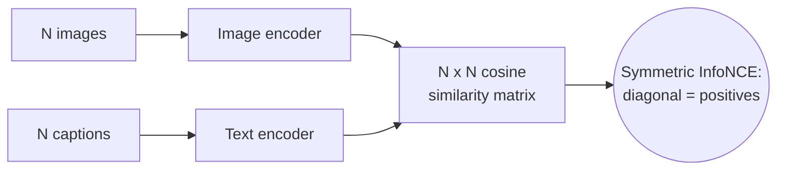

# 6.6 Weak supervision and vision-language models

Part of [6. Self-supervised and transfer learning](README.md). [Slides 48-50](slides.pdf#page=48) and [54](slides.pdf#page=54).

> [!TIP]
> **Key takeaways**
>
> - Weak labels such as captions are noisy, but available for billions of images; at that scale, quantity beats quality.
> - CLIP applies contrastive learning to image-caption pairs, which gives zero-shot classification with text prompts.
> - SigLIP replaces the batch-wide softmax by a sigmoid per pair, which is cheaper and scales better.

## Notes

### Weak supervision signals

Real-world data rarely comes with perfect labels, but it often comes with *some* information about its content:

| Fully supervised | Weakly supervised | Self-supervised |
| --- | --- | --- |
| Perfect labels | Imperfect labels | No labels |
| "cat", "dog", ... | "With Boxer in the park" | – |

In weakly supervised learning (WSL), the labels describe the content of the image, but are noisy, incomplete or indirect. Common sources in computer vision:

- image captions and tags, for example from image search;
- web metadata: alt-text, hashtags, the text around an image;
- social-media posts.

WSL chooses **quantity over quality**. Such labels are available for billions of images, and at that scale the quantity compensates for the noise.

### CLIP

CLIP (Radford et al., 2021) trains an image encoder and a text encoder on about 400 million image-caption pairs from the internet. It is contrastive learning as in [6.5](5-contrastive-learning.md), but the positive pair is now an image and **its caption**, instead of two augmentations of the same image.

For a batch of $N$ pairs, CLIP computes the $N \times N$ matrix of cosine similarities between all image and text embeddings. The $N$ matching pairs on the diagonal are the positives, all other combinations are negatives. The loss is a **symmetric InfoNCE**: a softmax cross-entropy over each row (find the right caption for an image) and over each column (find the right image for a caption).

Because the model learned to match images to free text, it can classify images **zero-shot**, for classes it was never explicitly trained on: embed a prompt such as "a photo of a {class}" for every class, and pick the class whose text embedding is most similar to the image embedding.

### SigLIP

The softmax in CLIP's loss normalizes every row and column over the whole batch. With very large batches spread over many GPUs, this needs the full similarity matrix and a lot of communication. SigLIP (Zhai et al., 2023) replaces it with a **sigmoid loss**: every image-text pair becomes an independent binary classification, "do these belong together?", with label $z_{ij} = 1$ for matching pairs and $z_{ij} = -1$ otherwise:

$$
\mathcal{L} = -\frac{1}{N} \sum_{i=1}^{N} \sum_{j=1}^{N} \log \sigma\!\left(z_{ij}\,(t\, \mathbf{x}_i^\top \mathbf{y}_j + b)\right)
$$

with a learnable temperature $t$ and bias $b$. Since no term depends on a normalization over the batch, the loss can be computed in chunks, uses less memory, and works well with both small and very large batches.

SigLIP 2 (Tschannen et al., 2025) combines this weakly supervised objective with self-supervised ones: self-distillation and masked prediction as in DINO and iBOT, plus captioning, which improves dense (per-pixel) features and localization.

## Check your understanding

What is the advantage of a sigmoid-based loss over a softmax-based loss?

The softmax normalizes over all pairs in the batch, so every term depends on the whole $N \times N$ similarity matrix, which must be gathered across all GPUs. The sigmoid treats every pair independently: the loss can be computed in chunks, uses less memory, and is less sensitive to the batch size.

How would you use CLIP to classify surgical instruments it was never trained on, and what could go wrong?

Write a prompt per class ("an endoscopic image of a grasper", "... of scissors"), embed the prompts and the image, and pick the most similar prompt. It may fail because surgical images and their vocabulary are rare in web data: the model may not know what the terms look like, which is why domain-specific pretraining or fine-tuning is often needed.

Why do noisy captions work at all as labels?

The noise is mostly random, while the signal is consistent: across millions of images, "dog" co-occurs with dogs much more often than with anything else. With enough data, the consistent part dominates what the model learns.

## Further reading

- A. Radford et al., "Learning transferable visual models from natural language supervision," *ICML*, 2021. [arXiv](https://arxiv.org/abs/2103.00020)
- C. Jia et al., "Scaling up visual and vision-language representation learning with noisy text supervision," *ICML*, 2021. [arXiv](https://arxiv.org/abs/2102.05918). ALIGN: CLIP-style training on a billion noisy pairs.
- X. Zhai, B. Mustafa, A. Kolesnikov and L. Beyer, "Sigmoid loss for language image pre-training," *ICCV*, 2023. [arXiv](https://arxiv.org/abs/2303.15343)
- M. Tschannen et al., "SigLIP 2: Multilingual vision-language encoders with improved semantic understanding, localization, and dense features," 2025. [arXiv](https://arxiv.org/abs/2502.14786)
- D. Mahajan et al., "Exploring the limits of weakly supervised pretraining," *ECCV*, 2018. [arXiv](https://arxiv.org/abs/1805.00932). Pretraining on 3.5 billion Instagram images with hashtags as labels.

Next: [6.7 Foundation models](7-foundation-models.md).
